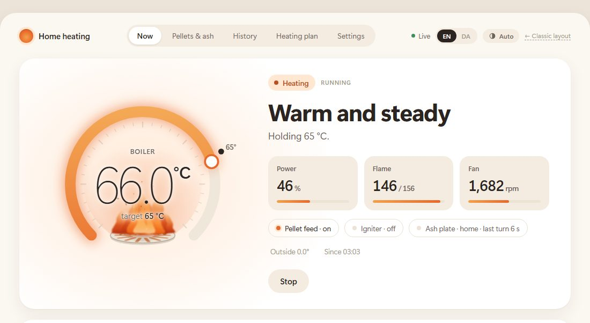
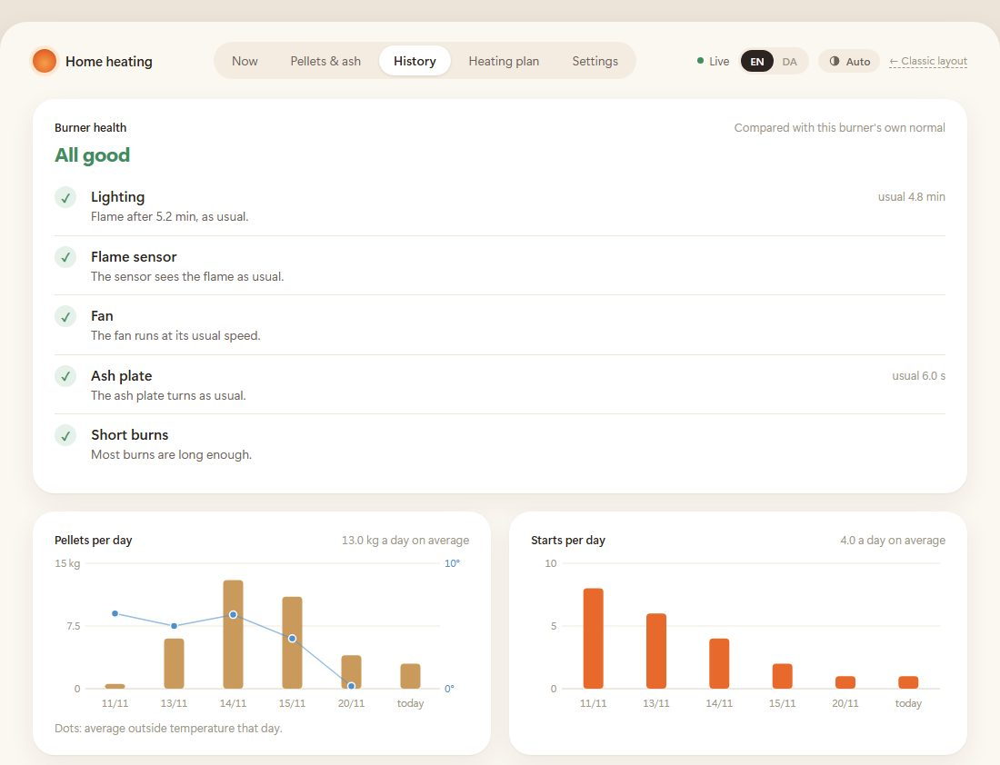
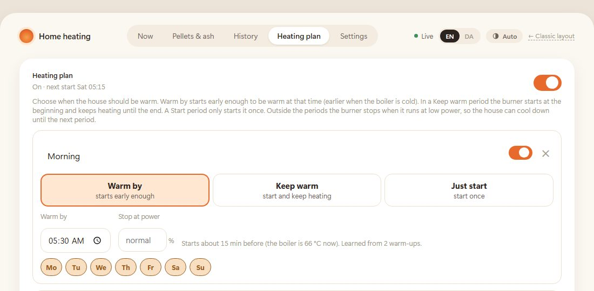
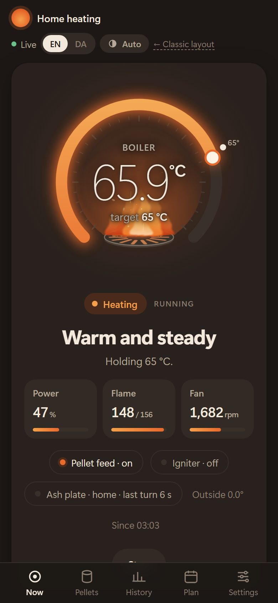
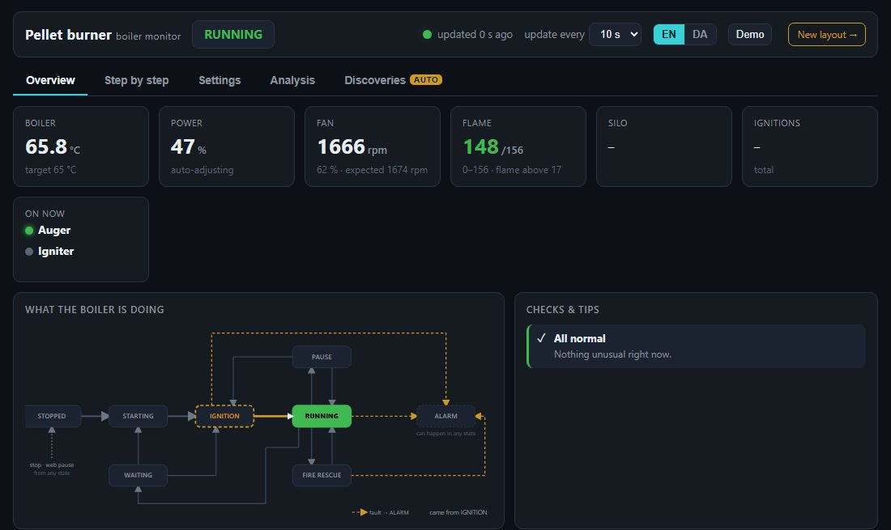
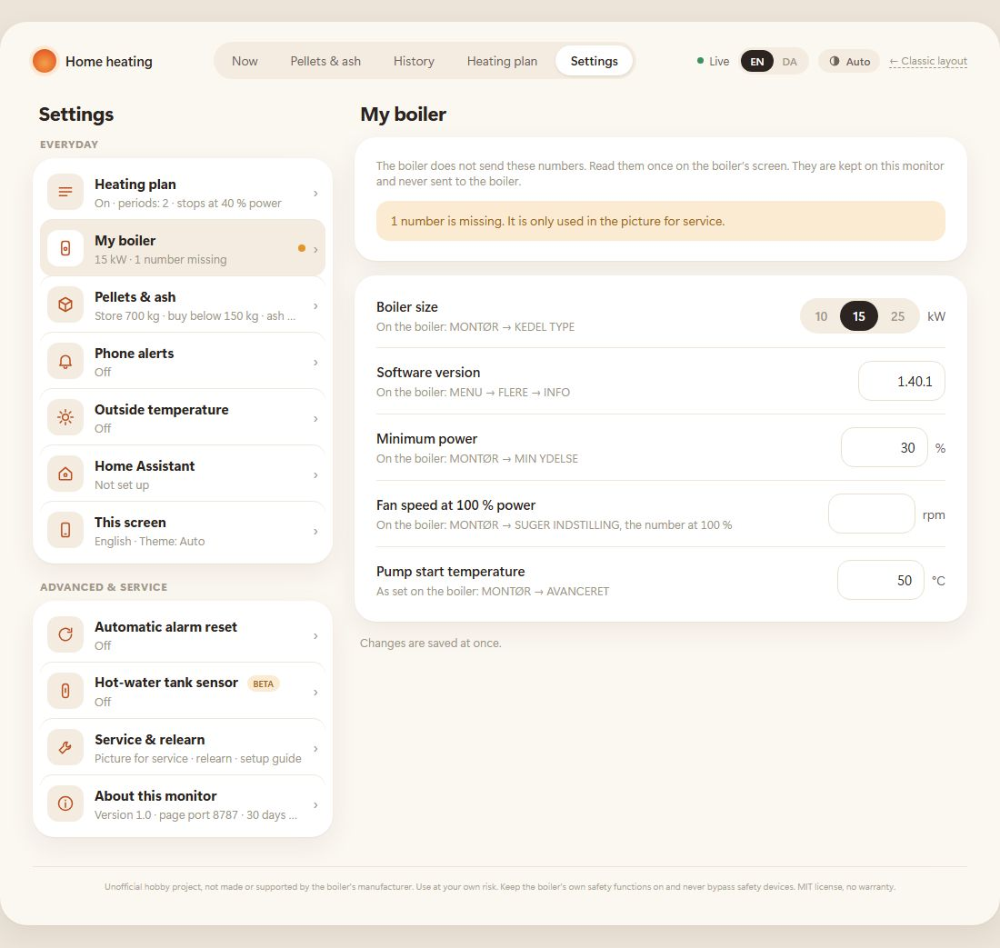
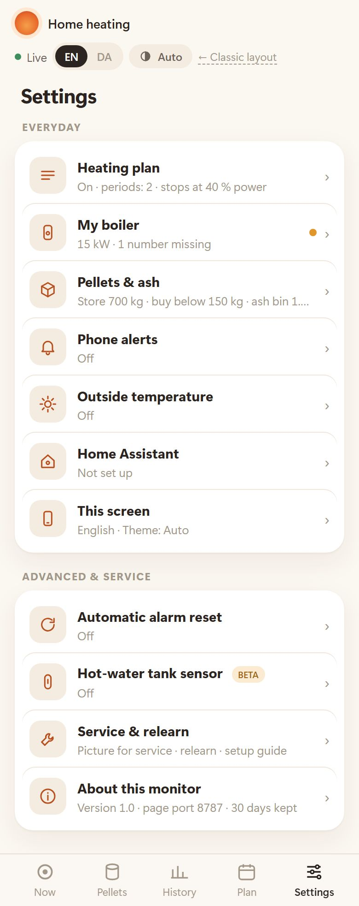

# Pellet burner monitor

> **Using an AI assistant** (ChatGPT, Claude, Copilot ...) to install it? Let it read [`AI.md`](AI.md) first.

## Easy install (Raspberry Pi, no typing)

> **New, not tested on a real card yet.** Try it on a spare card first; the manual setup below is the tested way.

1. In **Raspberry Pi Imager** choose *Raspberry Pi OS Lite (64-bit)*. In Imager's settings set the host name
   `pelletpi`, a user name and password, your Wi-Fi and your time zone. Write the card.
2. Unzip **`pelletpi-card.zip`** (from the releases page) onto the card's boot drive (`bootfs`): the folder
   `pelletpi` and the file `vendor-data`. If the drive is gone after writing, take the card out and put it back.
3. Put the card in the Pi, plug the USB adapter into the boiler's module port, and switch the Pi on.
4. Wait about 15 minutes, then open **http://pelletpi.local** on your phone or PC (same Wi-Fi).

The Pi needs internet the first time; without it, it waits and tries again every minute. To see progress,
open http://pelletpi.local while it installs, or put the card in a PC and open `pelletpi-status.txt`.
Every night it installs a new release by itself, but only while the burner is off or waiting
(turn off: `AUTO_UPDATE=no` in `pelletpi/settings.txt`). Details and the untested parts: [`pi/README.md`](pi/README.md).

**Wi-Fi typo or a new router? No PC needed** (new, not tested on a real Pi). When the Pi has no network for
3 minutes, it opens the Wi-Fi **`pelletpi-setup`** (no password). Join it with your phone, open
**http://10.42.0.1:8099**, pick your Wi-Fi and type its password. The hotspot turns off when the Pi is on your
Wi-Fi, or after 15 minutes. A network cable to the router works too.

A small program and web page for a home pellet burner. It listens on the burner's module port, saves the
history, and shows it on a friendly page (English or Danish) on your phone or PC:

- what the burner is doing right now, with a live picture of the fire
- a heating plan: "warm by 05:30", "keep warm 17:15-19:30", "start at 09:00". Under the plan: was the boiler
  warm in time the last mornings, and how many kg of pellets each period uses a day
- pellets left at home, ash bin fill level, burner health compared with its own normal
- history charts (short burns under 30 min show as the light part of "Starts per day"), lighting times per start
  and per pellet batch, outside temperature (optional)
- **Share my burner** (on History): one picture with your burner's numbers to post in a group. It holds no
  place, names or pellet brand, and nothing is uploaded: the picture is saved on your phone or PC.
  **Picture for service** next to it makes a tall picture for troubleshooting help: settings against factory,
  the last 10 starts, flame and fan by power, burn lengths, boiler temperature, ash plate turns, alarms and data gaps.
  The first time, it asks for three numbers the boiler does not send (software version, MIN YDELSE, fan rpm at 100 %);
  they are kept on the monitor (change them in Settings → My boiler) and never sent to the boiler. Skip is fine.

It runs offline. Only the optional outside temperature uses the internet (Open-Meteo, no account).

> **📘 The full guide:** [`docs/guide.html`](docs/guide.html) — setup, alarms and troubleshooting, how the
> controller works, the module port and protocol. One file that works offline: download it (the **Download raw
> file** button on GitHub), open it in any browser, and use *Print → Save as PDF* for a PDF.

> **Unofficial — use at your own risk.** This is a hobby project, not made, checked or supported by the
> boiler's manufacturer. The module protocol was worked out by listening to the wire and may be wrong for
> your boiler or software version.
>
> **Never bypass safety devices** (thermal safety switch, sensors, fuses, alarms). Keep the boiler's own
> safety functions on, and let a person look at an alarm before the boiler is restarted. The program never
> resets alarms by itself unless you switch that on. Switch the boiler off before touching the board: part
> of it carries 230 V.
>
> The same short notice is at the bottom of both web pages.

## Screenshots

| Now | History | Heating plan |
|---|---|---|
|  |  |  |

| Phone, dark theme | Classic layout (`/classic`) |
|---|---|
|  |  |

| Settings | Settings on a phone |
|---|---|
|  |  |

## What you need

- A Raspberry Pi 4 (or any Linux PC) with Docker
- A USB-RS-485 adapter with automatic direction control (FTDI, CH340, CP210x and similar)
- A network cable with one end cut off, for the boiler's module port J4
- The burner set to allow a remote module: AVANCERET → EKSTRA UDSTYR → IO BOKS on

**Wiring** (T568B colours; J4 is RS-485, not Ethernet, so never plug it into a router or PC):

| J4 pin | Colour | Adapter |
|---|---|---|
| 1 | white-orange | B (D−) |
| 2 | orange | A (D+) |
| 3 | white-green | GND |

Tape off all other wires (they carry power). Leave the adapter's terminator off. Switch the boiler off before
plugging in: part of the board carries 230 V. Pictures and details: the guide's *Communication port (J4)*.

## Which controller software is supported

- **Works with** controller software 1.30 or newer (from 2018), which has the Wi-Fi / IO box connection the
  monitor uses. Tested on 1.40 (the maintainer's boiler). 1.40.1 and 1.41 use the same connection and should
  work; 1.41 only adds a cloud address for the Wi-Fi module (not tested live yet).
- **Not supported:** software older than 1.30, for example 1.13 (2015). It has no Wi-Fi / IO box connection,
  only the old SMS box link. Updating the controller software is a job for the dealer.
- **Boiler types:** 10 kW (shown as "1200GP" from 1.40), 15 kW ("1700GP") and 25 kW all work. The type is set
  on the boiler (MONTØR → KEDEL TYPE); set the monitor's boiler size (Settings → My boiler) to match.
- **Hardware** V3 and V4. Check software and hardware in MENU → FLERE → INFO.

## Quick start (Docker)

```bash
git clone https://github.com/Aemp-Aemp/pelletburner-monitor.git
cd pelletburner-monitor
docker compose up -d --build
```

**Or all in one** on a fresh Raspberry Pi OS: after `cd pelletburner-monitor` run `sudo sh pi/install.sh`. It
installs Docker, starts the monitor and sets up the page on port 80, Pi health logging and the safe nightly
auto-update. Then open `http://pelletpi.local`. Safe to run again; leave a part out with `NO_PORT80=1`,
`NO_LOGGING=1` or `NO_UPDATE=1` (example: `sudo NO_UPDATE=1 sh pi/install.sh`).

Open `http://pelletpi.local:8787` (or `http://<pi-address>:8787`) in a browser on the same network. This assumes
the Pi's host name is `pelletpi`; with another name, use the address, or add `<name>.local` to
`BURNER_ALLOWED_HOSTS` (see below; `pi/install.sh` does this for you). To drop the
`:8787`, run `sudo sh pi/enable-port-80.sh` once; then it is just `http://pelletpi.local`. The older, more
technical page is at `/classic`.

- **Serial port:** found by itself when one USB-serial adapter is plugged in. See "Connecting the boiler".
- **Data:** history, settings and pellet counts are kept in `./data` and survive updates.
- **Who can use the buttons:** `BURNER_ALLOWED_HOSTS` (default `lan,pelletpi.local`) lists the addresses
  the page may be opened under. `lan` means any private IPv4 address on your home network. Everyone who can
  reach those addresses can use the buttons, so keep the Pi on a network you trust.
- **Settings:** copy `.env.example` to `.env` next to `docker-compose.yml`, remove the `#` in front of what you
  want to change, then `docker compose up -d`. No code needs to be edited. You can set the page port, view only
  (`BURNER_REMOTE_START=0`: no start/stop), days of history kept, log size, the serial adapter and Home Assistant.

## First start: the setup guide

The first time the page is opened on a new monitor, it shows a short step-by-step guide instead of the normal page.
Every step has Back, Skip and Next, and everything can be changed later in Settings. The answers are kept on the
monitor, so every phone and PC sees them. The guide never starts, stops or changes the boiler. To see it again:
Settings → Service & relearn → **Run the setup again**.

1. **Language**: English or Danish.
2. **Welcome**: shows live if the boiler is connected. If not, check the cable and that the boiler has
   EKSTRA UDSTYR → IO BOKS on. You can go on anyway.
3. **Your boiler**: size (10, 15 or 25 kW, filled in from the boiler when it can), software version, minimum power and
   fan rpm at 100 %. The same three numbers as for **Picture for service**, which then does not ask again.
4. **Outside temperature** (optional): pick your town. Only its rounded coordinates are sent.
5. **Pellets**: how much your store or silo holds, how much is at home now, the name on the bag (optional).
6. **Ash bin**: mark it as emptied now (optional).
7. **Heating plan**: warm in the morning, keep warm in the evening, both, or no plan yet. The plan is saved but stays
   off until you turn it on on the Plan page.
8. **Done**: a short summary and **Open the page**. "Skip the setup" at the top also ends it.

## Settings

Settings is a short list of groups. Each row shows its state in one line and opens its own small page. On a PC
the list stays on the left and the group opens beside it.

- **Everyday:** Heating plan (on/off and the stop and start rules) · My boiler (boiler size and the numbers the
  boiler does not send) · Pellets & ash (silo size, "buy before" reserve, ash bin size) · Phone alerts ·
  Outside temperature · Home Assistant (read-only: what the `.env` file says, the password only as "set") ·
  This screen (language, theme, animations).
- **Advanced & service:** Automatic alarm reset · Hot-water tank sensor · Service & relearn (Picture for service,
  "I cleaned the flame sensor", "Fan replaced or fan settings changed", reset the history, run the setup again) · About this
  monitor (version, page port, days kept).

**Changes are saved at once**: a switch when you tap it, a number when you leave the field or press Enter.
"Saved" shows under the field. A wrong value gets one plain line ("Type a whole number from 10 to 100.") and the
old value stays in use. Turning on the heating plan or the automatic alarm reset asks first. Two places keep their
own button: the period editor on the Plan page (Save) and the setup guide (Next). The classic page keeps its own
Settings tab.

## Security

The monitor is made for a home network you trust. It has no log-in.

- **Anyone who can open the page can use it all:** start and stop, alarm reset, the heating plan and every
  setting. The page also shows the phone-alert topics and the phone PIN. For a page that can only look, set
  `BURNER_REMOTE_START=0` (no start or stop from the page or Home Assistant).
- **Other websites can't use it.** The page only works under the names in `BURNER_ALLOWED_HOSTS`, and every
  change needs a special header that a web page you visit can't send. So a bad web page can't read or press anything.
- **Never open a port in your router** for the monitor. From outside the home, use Home Assistant's remote
  access or phone alerts (ntfy): both work without an open port.
- The Wi-Fi setup hotspot `pelletpi-setup` has no password. It only runs while the Pi has no network, and turns off
  when the Pi is on your Wi-Fi.
- The boiler's own safety stays on whatever the monitor does.

## Connecting the boiler (USB)

- **Use one USB-serial adapter.** The program looks for it by itself (`BURNER_PORT=auto`): FTDI, CH340, CP210x
  and similar adapters (they show up as `/dev/ttyUSB…` or `/dev/ttyACM…`). Any USB socket on the Pi works.
- **Unplugging is fine.** If the adapter is unplugged, moved to another socket, or the boiler is switched off
  and on, the program finds it again within a few seconds. No restart is needed.
- **More than one USB-serial adapter?** The program will not guess. The log says which ones it found; put the
  boiler's one in a `.env` file next to `docker-compose.yml`, using its stable name:
  `BURNER_SERIAL=/dev/serial/by-id/usb-FTDI_FT232R_USB_UART_XXXXXXXX-if00-port0`
  (list them with `ls /dev/serial/by-id/`). Other USB things (keyboard, USB stick) do not matter.
- **Only one program on the boiler.** Never let two programs (e.g. an old PC copy and the Pi) talk to the
  module port at the same time.
- **Keep the gaps short.** When the boiler hears nothing from the module port for a while it shows
  alarm 15 "External IO", which has to be reset on the boiler. Updating the program takes only a few seconds;
  build first (`docker compose build`), then `docker compose up -d`.
- **Power.** Give the Pi its own good 5 V / 3 A USB-C power supply. A weak supply shows as `undervolt` in the
  Pi health log.

## Troubleshooting (top 5)

1. **No data on the page.** Check IO BOKS is on and the cable is in J4. Still nothing? Swap A and B.
2. **Alarm 15 "External IO" on the boiler.** The monitor was silent for about 50 s (stopped, unplugged,
   updating). Reset it on the boiler; it does not come back while the monitor runs.
3. **The page does not open.** Use the same Wi-Fi, add `:8787`, or use the Pi's address instead of
   `pelletpi.local`. Check `docker compose ps` and `docker compose logs`.
4. **Two USB-serial adapters.** The program will not guess; set `BURNER_SERIAL` (see "Connecting the boiler").
5. **Plan times are off.** The Pi's clock is behind after a restart without internet (see "Without internet").

Boiler alarms and what to check: the guide's *Troubleshooting* section.

## Without internet

The program works fully offline; only the outside temperature waits for the internet. Two things to know:

- **The clock.** A Raspberry Pi 4 has no clock battery. It sets its clock from the internet. If it restarts
  while there is no internet, its clock starts from where it was when it stopped, so it is behind until the
  internet is back. The heating plan uses this clock. The Pi health log shows `clock_synced` for every minute.
- **Logs for analysis.** Everything is kept in `./data` on the Pi (how long: see "Disk use" below):
  `hist-*` (one line every few seconds), `raw-*` (every value, every second), `events-*` (starts, stops,
  alarms), `ignitions.jsonl`, `responder.log`, and `pi-health-*` (once a minute: clock, temperature, power,
  Wi-Fi, internet, USB adapter, container). Install the Pi health log once with
  `sudo sh pi/install-pi-logging.sh`; it also keeps the system journal across restarts
  (`journalctl -b -1` shows the start before, e.g. USB plug events).
  To take the logs home: `scp -r pi@<pi-address>:pelletburner-monitor/data ./burner-data`.

## Disk use and how long data is kept

With the defaults the monitor uses about 1.5 GB at most, so a 16 GB card is plenty. Old files are deleted by
the program itself (at start and every 6 hours, by the time a file was last written).

| What | Kept | Size |
|---|---|---|
| `hist-*`, `events-*`, `raw-*`, `summary-*`, `prealarm-*` | `BURNER_KEEP_DAYS` days (30; `0` = never delete) | `raw-*` is the big one: ~35 MB a day, ~1 GB for 30 days. The page does not need it; it is only for analysis. |
| `responder.log` | new file at `BURNER_LOG_MAX_MB` (50 MB), 3 old ones kept | up to ~200 MB |
| `pi-health-*` | 30 days | a few MB |
| Docker's own log (`docker compose logs`) | 3 files of 10 MB | 30 MB |
| System journal (after `install-pi-logging.sh`) | up to 200 MB | 200 MB |
| `ignitions.jsonl`, `lux_samples.jsonl`, `fan_samples.jsonl`, `ash_turns.jsonl`, `weather.jsonl` | kept, the page learns from them | a few MB a year |
| `settings.json` and other small state files | kept | tiny |

Small card? Set `BURNER_KEEP_DAYS=7` in `.env`. The settings page shows the days kept and the log size.

## Raspberry Pi with SSH over the USB-C cable

`pi/` holds a one-time setup script for Raspberry Pi OS (Trixie, 64-bit). It turns the Pi 4's USB-C port into
a network cable: plug the Pi into a Windows, macOS or Linux PC and it shows up as a network adapter, with no
driver to install. The Pi is then at `10.55.0.1` (`ssh pi@10.55.0.1`). See `pi/README.md`.

`tools/tunnel_proxy.py` lends the PC's internet to the Pi through the SSH connection, for when the Pi has no
Wi-Fi yet (for installing Docker).

## Home Assistant

The monitor can send all its values to Home Assistant over MQTT, using Home Assistant's own **Mosquitto broker**
add-on.

1. In Home Assistant: install the Mosquitto broker add-on and make a Home Assistant user for the monitor
   (Settings → People → Users), for example `burner`.
2. On the Pi, in the `.env` file next to `docker-compose.yml`:
   ```
   BURNER_MQTT=homeassistant.local
   BURNER_MQTT_USER=burner
   BURNER_MQTT_PASS=the-password
   ```
   Use Home Assistant's address on your network if `homeassistant.local` is not found. Then `docker compose up -d`.
3. One device, **Pellet burner**, appears by itself under Settings → Devices & services → MQTT.

**What appears:** state (words and number), alarm (number and text), boiler, outside (when turned on) and flue
(only with a flue sensor) temperature, setpoint, power, flame, fan % and rpm, auger, igniter, ash plate, silo,
pellets left / per day / days left, ash bin fill, burner health checks, last start and its lighting time, the
heating plan's next start, data age, boiler link, monitor version, and Pi health (CPU temperature and load, free
disk and memory, uptime, Wi-Fi, internet, under-voltage, USB adapter). When the monitor stops, everything shows
"unavailable".

**Start and stop:** *Start burner* / *Stop burner* buttons, and switches for the heating plan and the auto-start
schedule. The buttons follow the same rules as on the monitor's page: they only exist with `--allow-remote-start`
(on in the Docker setup), the command reaches the boiler within about 30 s, and nothing is sent while the boiler
is in ALARM (an alarm is always reset on the boiler or on the monitor's page; there, Start/Stop during an alarm
first asks you to confirm the reset). `BURNER_MQTT_READ_ONLY=1` sends
values only.

**Hot-water tank temperature from Home Assistant:** if a sensor in Home Assistant measures the hot-water tank,
the monitor can pass it on to the boiler (shown there as the tank temperature, for hot-water priority). Turn the
hot-water tank sensor on in the monitor's settings with source MQTT, and let Home Assistant send the number to
`burner/cmd/vvb` every few minutes (not retained), for example with this automation:

```yaml
- alias: Tank temperature to the pellet burner
  triggers:
    - trigger: time_pattern
      minutes: "/2"
  actions:
    - action: mqtt.publish
      data:
        topic: burner/cmd/vvb
        payload: "{{ states('sensor.hot_water_tank') }}"
```

With no reading for 15 minutes the monitor reports a safe "warm" value, so a dead sensor never makes the boiler
heat. This also works with `BURNER_MQTT_READ_ONLY=1`. Boiler settings are never changed over MQTT.

**From outside the home:** use Home Assistant's own remote access. The monitor stays on the home network.

**Check it:** `python scada/mqtt_check.py --env .env` listens for 40 s and checks everything that is sent.

## Phone alerts (ntfy)

The monitor can send a message to your phone when something happens at the boiler. It uses
[ntfy](https://ntfy.sh): a free app, no account needed. Off until you turn it on.

1. Install the **ntfy** app on your phone (Android or iPhone).
2. On the monitor's page: **Settings → Phone alerts**. In the ntfy app press **+**, type the topic
   (shown on the page, with a **Copy** button) and subscribe — or scan the QR code with the phone's camera
   to open the link. The ntfy app has no QR scanner of its own.
3. Turn alerts on, and press **Send test**.

**Anyone who knows the topic can read the alerts.** The topic is made at random the first time
(`burner-` + 24 random characters) and works like a password: keep it to yourself. It is not sent to Home
Assistant and not written in full to the logs. **New alerts topic** (next to the topic) makes another one: anyone with the
old link gets nothing more, the old topic gets one last message ("Subscription ended"), and every phone has to
subscribe to the new topic. You can also use your own ntfy server: the server and the
certificates are in the folded part **Own server and certificates**.

**Events** (each can be turned on or off; shown as Problems, Reminders and Activity; the first seven are on):
boiler alarm (with the alarm's name) · alarm gone · no contact with the boiler for 5 minutes · contact back ·
silo low (the boiler's silo counter below a limit, 50 kg by default) · ash bin almost full / burner needs
cleaning / ash-plate problem · the Pi itself (disk almost full, too little power, too hot; needs the Pi health
log) · burner started (and by whom) · burner stopped · monitor (re)started · a short summary of the day at a
time you choose. The same message comes at most once every 30 minutes; an alarm is told once, also when the
monitor restarts while it is still on. Messages are in the page's language (English or Danish).

A failed start is not a separate message: the boiler always stops with alarm 4 "Start-up failed", which is sent
as an alarm.

**Certificates:** the connection to the server is always checked (this can't be turned off). The certificate
list is kept in `data/ca/`; **Update certificates** fetches a new one from curl.se, checked with the current
one, and keeps the old as `.bak`. If sending fails with a certificate problem, check the Pi's clock first — a
wrong clock breaks certificates.

### Start/stop from the phone (optional, off)

Start or stop the boiler from the ntfy app, from anywhere. Set it up under **Settings → Phone alerts → Start/stop
from the phone**: type a PIN (4–6 digits) or press **Make a PIN**, save it, then turn it on.
The page shows the PIN (anyone who can use the page can start the boiler anyway) and warns if it is easy to guess. Alerts must
be on, and remote start/stop must be allowed (`BURNER_REMOTE_START=1`, the Docker default).

1. In the ntfy app, subscribe to the **command topic** too (a second secret topic, shown on the page with a Copy
   button). Then you can send to it.
2. Tap **Start** or **Stop** on an alert, or type `start` or `stop` in the command topic.
3. The monitor answers on the alerts: "To start the boiler reply: 4821 &lt;your PIN&gt; (valid 2 min)". Reply in
   the command topic with the code, a space and your PIN. Only then the command is sent.

Type `status` for a short answer (state, boiler °C, alarm, last start; no PIN needed). Anything else gets a
short "Not understood" help, at most once a minute.

**Safety:** anyone who knows the command topic **and** your PIN can start or stop your boiler; keep both to
yourself. The monitor never sends your PIN; you type it only in your reply. The one-time code is new every time,
works for 2 minutes and only once (an old "start" message sent again does nothing). One command waits at a time.
3 wrong tries lock phone commands for 15 minutes, with an alert. A boiler in alarm is refused (and you are told);
the phone never resets an alarm. The command goes the same way as from Home Assistant or the web page, and the
boiler's own safety stays on. The PIN is shown only on the monitor's own page. The monitor only listens outwards to the
ntfy server (no port is opened); the command topic is not sent to Home Assistant and not written in full to the
logs. Note: the Start/Stop buttons on the alerts hold the command topic, so someone who can read your alerts can
also see it — they still need your PIN. **New command topic** makes another one.

## Try it without a boiler (demo)

Any PC with Python 3 can show the page with no boiler and no adapter. This makes up three days of a pretend
boiler and plays the morning through the real program, one hour per minute. Nothing is sent anywhere: no serial
port is opened and the start/stop buttons are off.

```bash
python -c "import sys; sys.path.insert(0, 'scada'); import _synth; _synth.make_data('demo-data', days=3, raw=(2, 5, 10))"
python tools/replay.py --data demo-data --from "2000-01-03 05:30" --to "2000-01-03 09:30"
```

Open `http://127.0.0.1:8790/home`. On Windows use `py` instead of `python`. `--at 06:10` jumps to that time and
holds; `--speed 1` is real time. To replay your own day, point `--data` at a copy of the monitor's `data` folder
(it is only read). More options: [`tools/REPLAY.md`](tools/REPLAY.md).

## Tests

```bash
cd scada
for t in _*_test.py; do python "$t" || echo "FAILED: $t"; done
cd .. && python pi/_card_test.py      # static checks of the card / auto-update scripts (works on Windows)
```

Before a release: `python tools/release_check.py` (needs Playwright) runs the real program against a fake boiler, a
fake ntfy server and a local MQTT broker, checks every function end to end, then the Pi scripts and the whole test
suite. About 10 minutes, nothing leaves the PC. `--quick` skips the test suite.

## Files

| File | What it does |
|---|---|
| `burner_responder.py` | Talks to the burner's module port, serves the web page, runs the heating plan |
| `burner_features.py` | Heating plan, pellets, ash, burner health, ignition log, weather |
| `burner_ext.py` | Saving history, MQTT / Home Assistant bridge, settings sync |
| `burner_notify.py` | Phone alerts (ntfy) and their certificates |
| `burner_phone.py` | Start/stop from the phone (ntfy): PIN and one-time code |
| `burner_common.py` | Shared tables (state and alarm names) and small helpers |
| `burner_sniff.py` | Frame decoder (listen-only tool) |
| `scada/home.html` | The main page |
| `scada/dashboard.html` | The classic, more technical page |
| `scada/insights_gen.py` | Builds the "Discoveries" cards from the history |
| `pi/` | Raspberry Pi first-start setup (USB-C network, status report), safe auto-update |
| `pi/firstboot/` | Easy install: the files that go on the card (see `pi/README.md`) |
| `scripts/` | `make_card.py` builds `pelletpi-card.zip`; `make-image.sh` builds a ready card image |

## Contributing

Bug reports, boiler data and fixes are welcome: see [`CONTRIBUTING.md`](CONTRIBUTING.md) for what to include
(controller software version, logs) and what to remove first.
What changed in each version: [`CHANGELOG.md`](CHANGELOG.md). The monitor's version is at the bottom of the page.

## License

MIT, see [`LICENSE`](LICENSE). Copyright (c) 2026 The pellet burner monitor contributors.
You may use, change and share it freely; it comes with no warranty.
